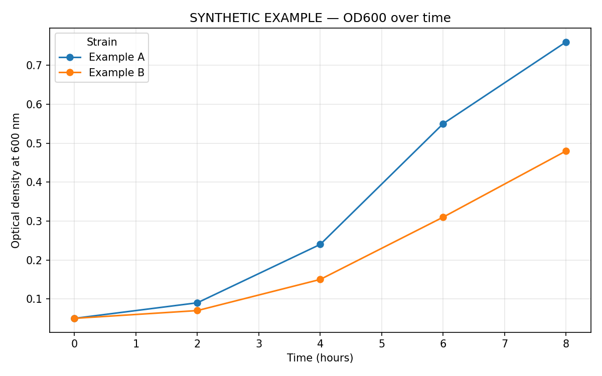

# OD600 visualisation

[Plotting script](plot_growth.py) · [Synthetic example CSV](example_growth.csv)

Plots optical-density observations over time. The original experimental CSV was not present in the repository, so its old figure could not be independently reproduced. The maintained example uses explicitly synthetic values, with provenance in the CSV and the plot title. It must not be presented as an experimental measurement.

## Run

From the repository root, using Python 3.12 and the pinned dependencies:

```bash
python -m pip install -r Bacterial-Growth-Visualization/requirements.txt
python Bacterial-Growth-Visualization/plot_growth.py --example --output Bacterial-Growth-Visualization/examples/synthetic_growth.png
python -m unittest discover -s Bacterial-Growth-Visualization/tests -v
```



For your own observations:

```bash
python Bacterial-Growth-Visualization/plot_growth.py --input /path/to/your_growth.csv --output outputs/growth.png
```

The CSV requires `Time_Hours`, `Strain` and `OD600`. Times must be finite and nonnegative, OD600 must be finite, and strain labels must be nonempty. Rows are sorted by time before plotting. Negative OD600 values are allowed because blank-corrected observations can be below zero; the script does not silently clip them.

If a strain has multiple observations at the same time, provide a nonempty `Replicate` identifier for each distinct series. Each replicate is drawn separately; the script does not silently average duplicates or invent confidence intervals. Duplicate strain/replicate/time rows are rejected. No growth-rate fitting, statistical comparison or interpretation of the synthetic curves is performed.

Three regression checks cover input validation, ordering, explicit replicates, plot generation and successful/failing command-line runs. The acetylcholinesterase project has its own separate tests.
