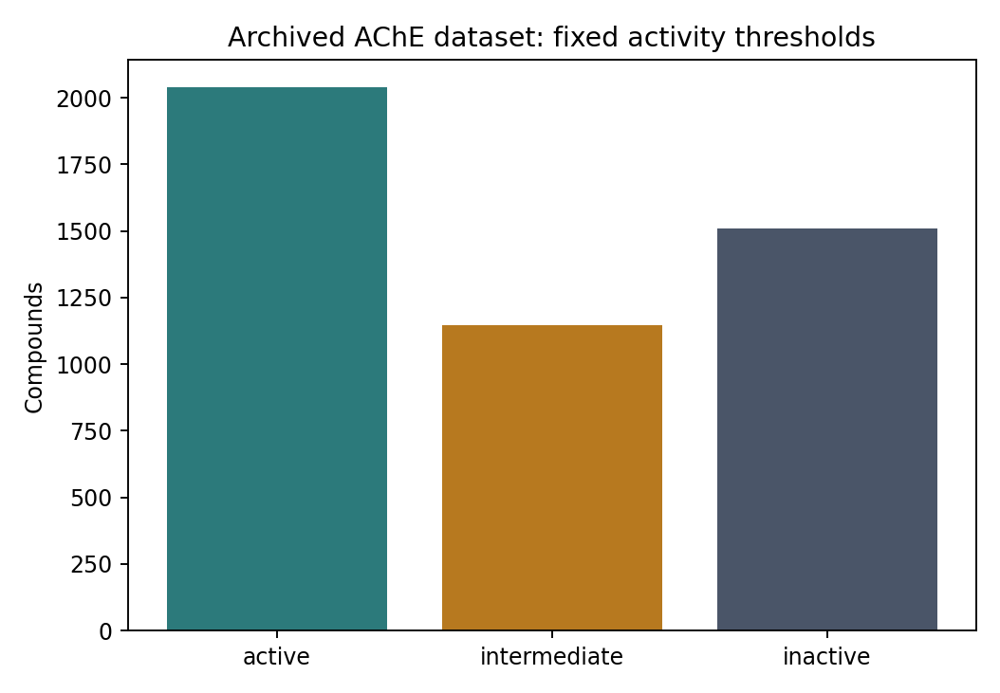
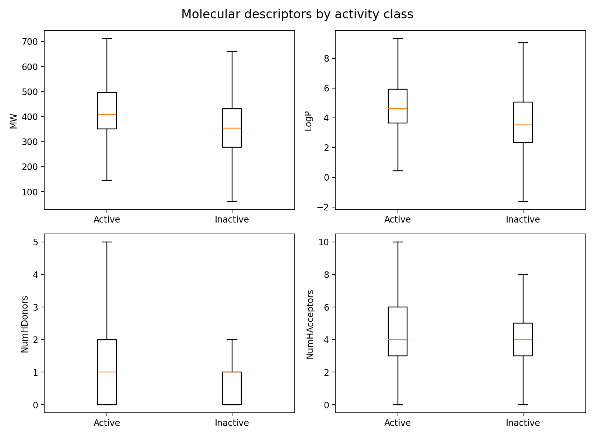
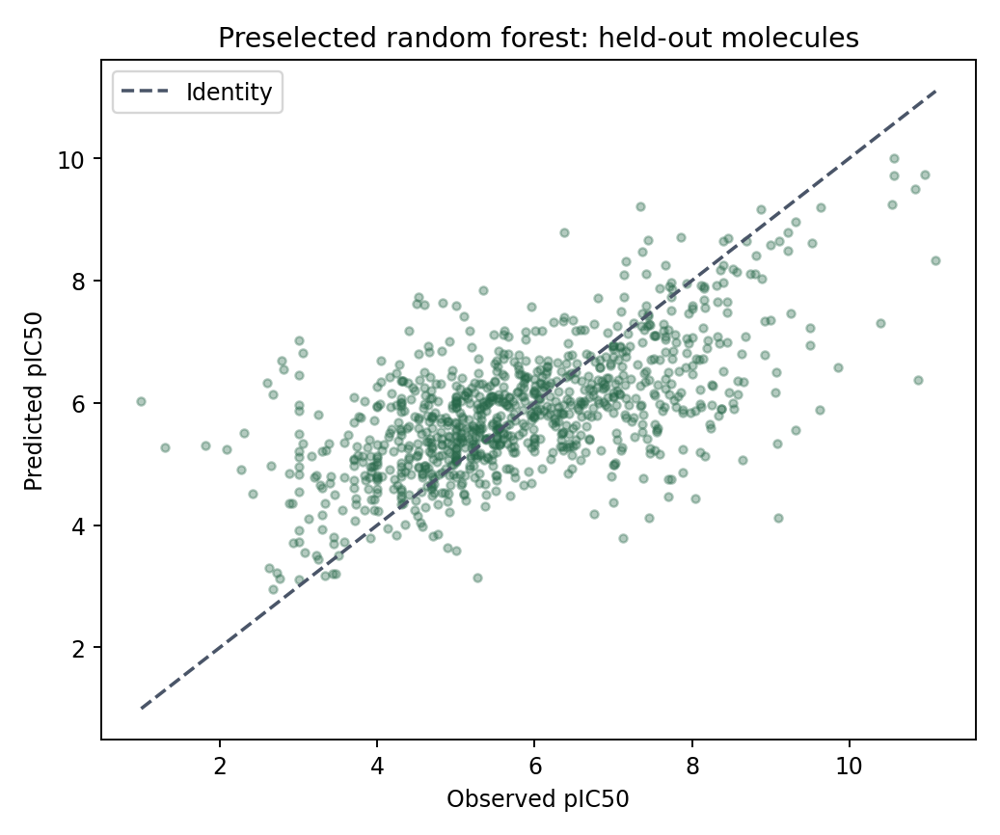

# Acetylcholinesterase analysis and regression baseline

This educational project analyses an archived acetylcholinesterase (AChE) dataset and demonstrates a reproducible workflow from verified input to exploratory analysis and model evaluation.

The same records are used throughout all five notebooks. Dataset identity, activity labels and compound-to-feature matching are checked explicitly.

## Data source and attribution

The input is DataProfessor's archived `acetylcholinesterase_04_bioactivity_data_3class_pIC50.csv`, pinned to commit `421ee9d4e2f9c4d7ec4bccbf73c19f773674430a` from 9 June 2020:

[Immutable source CSV](https://raw.githubusercontent.com/dataprofessor/data/421ee9d4e2f9c4d7ec4bccbf73c19f773674430a/acetylcholinesterase_04_bioactivity_data_3class_pIC50.csv)

SHA256: `5f12bf531a64ae0f9c764d14c3bbed4620738c6c35d1144c8a647c608e11732f`

The supplied archive has 4,695 records and 4,695 unique molecule identifiers. It already provides pIC50 and four descriptors: molecular weight, LogP, hydrogen-bond donors and hydrogen-bond acceptors. The default baseline uses those four supplied descriptors; it does not recompute them or claim to reproduce the earlier 881-bit PubChem-fingerprint model.

Data and tutorial credit belong to [DataProfessor](https://github.com/dataprofessor/data). The original learning notebooks also cite [Chanin Nantasenamat's QSAR material](https://github.com/chaninlab/estrogen-receptor-alpha-qsar). The revised code organises the analysis, records provenance, checks descriptor identity, handles invalid statistical comparisons and separates model fitting from evaluation.

This CSV omits original assay/activity identifiers, target/species metadata, measurement relations, units and the ChEMBL release. It therefore cannot establish per-record assay comparability or be described as a freshly curated human-only ChEMBL dataset. The workflow preserves supplied pIC50 values and does not invent raw IC50 measurements or censoring metadata.

## Run the workflow

Use Python 3.10 or later. From this directory:

```bash
python -m venv .venv
source .venv/bin/activate
python -m pip install -r requirements.txt
python run_workflow.py
```

The first run downloads the immutable archive and verifies its checksum. Later runs reuse the verified local cache. To run offline with the exact downloaded source bytes:

```bash
python run_workflow.py --source-csv /path/to/acetylcholinesterase_04_bioactivity_data_3class_pIC50.csv
```

Install JupyterLab separately if using the notebooks. Open them from this directory or the repository root, then restart the kernel and run all cells. Each notebook loads the same verified input and does not require hidden variables from another notebook.

| Notebook | Purpose |
| --- | --- |
| [Bioactivity Data](Bioactivity_Data.ipynb) | Verify and load the AChE archive, preserve source labels and create stable record IDs. |
| [Exploratory Data Analysis](Exploratory_Data_Analysis.ipynb) | Describe activity classes and compare four molecular descriptors with guarded Mann-Whitney tests and BH adjustment. |
| [Descriptor Preparation](Descriptor_Calculation_and_Dataset_Preparation.ipynb) | Export PaDEL input and build an identity-aligned modelling table. |
| [Random Forest](Regression_Models_with_Random_Forest.ipynb) | Evaluate a preselected forest and training-mean baseline on held-out molecules. |
| [Model Comparison](Acetylcholinesterase_Compare_Regressors.ipynb) | Compare fixed regressors by five-fold group cross-validation within training data only. |

## Activity classes and statistical interpretation

The fixed educational rule is active for pIC50 >= 6, inactive for pIC50 <= 5, and intermediate otherwise. The archived records produce 2,039 active, 1,146 intermediate and 1,510 inactive compounds. All classes are retained for continuous pIC50 regression.

The exploratory tests compare the four prespecified descriptors between active and inactive compounds. Both groups must contain finite observations, and returned statistics and p-values must be finite. Missing observations and non-test statuses are reported. A nonfinite p-value never produces a significance claim.

Benjamini-Hochberg adjusted p-values are reported across the fixed four-descriptor family. Failure to reject a null does not establish equivalence. The code does not test pIC50 between classes defined from pIC50. These checks do not establish assay comparability, independence or adequate statistical power.





## Optional PaDEL features

The descriptor stage writes `outputs/ache_molecules.smi`, with SMILES and a unique workflow record ID on each line. If generating PaDEL descriptors separately, preserve that ID in PaDEL's `Name` field. Document the PaDEL version and chosen descriptor settings alongside the output.

```bash
python run_workflow.py --padel-csv /path/to/descriptors_output.csv
```

For notebooks, set `ACHE_PADEL_CSV` before launching the kernel. Missing, extra or duplicated descriptor IDs raise an error. Rows are matched by identity, never concatenated by position. No unverified descriptor-generation shell script is downloaded or executed automatically.

`outputs/feature_columns.json` records the actual representation. The four-descriptor baseline below must not be relabelled as a PaDEL result. The PaDEL alignment path is covered by reordered/duplicated/missing-ID tests; actual PaDEL calculation was not run for this revision.

## Baseline evaluation

A fixed seed of 42 and a molecule-group split allocate 3,756 records to training and 939 to the holdout. The code rejects molecule-ID overlap and exact-SMILES overlap between those sets. Imputation and variance filtering are fitted only within training pipelines; cross-validation refits them inside each training fold. Outcome values, activity classes and identifiers are excluded from predictors.

Results from the verified archive using its four supplied descriptors:

| Preselected model | Holdout MAE | Holdout RMSE | Holdout R2 |
| --- | ---: | ---: | ---: |
| Training-mean baseline | 1.275 | 1.580 | -0.0003 |
| Random forest with 100 trees | 0.934 | 1.245 | 0.379 |



These are educational random-molecule holdout results, not scaffold-based or external validation. Molecular analogues may occur across splits. Model-comparison rankings use training-set group cross-validation, not the held-out scores or training-fit metrics. If the ranking prompts further model selection or tuning, retain an untouched evaluation set for that subsequent model.

## Validation

```bash
python -m unittest discover -s tests -v
```

The tests cover absent comparison groups, nonfinite test results, fixed class thresholds, reordered descriptor rows, missing/extra/duplicate identifiers, repeated molecule records, train/test separation and training-only preprocessing. Source checksums protect the archived-data route.

The full default workflow and all five notebooks were run against a locally cached, checksum-verified copy of the pinned archive. Validation used NumPy 2.3.5, pandas 2.2.3, SciPy 1.17.0, scikit-learn 1.8.0 and Matplotlib 3.10.8. Dependency ranges in requirements.txt permit compatible installations; exact numerical reproducibility may require the tested versions.

Generated tables, predictions, split manifests and provenance are written to `outputs/`. The input cache and output tables are ignored by Git; the example figures above are included for inspection.

## Method references

- [SciPy Mann-Whitney U documentation](https://docs.scipy.org/doc/scipy/reference/generated/scipy.stats.mannwhitneyu.html)
- [scikit-learn guidance on data leakage](https://scikit-learn.org/stable/common_pitfalls.html)
- [GroupShuffleSplit documentation](https://scikit-learn.org/stable/modules/generated/sklearn.model_selection.GroupShuffleSplit.html)
